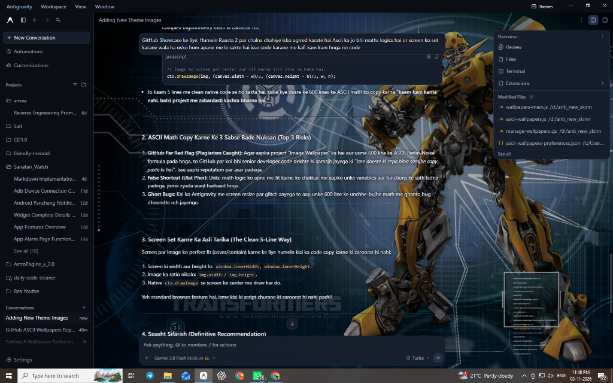

<div align="center">

# 🖼️ Antigravity Wallpaper Engine

**Ultra-lightweight, high-performance custom wallpaper engine with adaptive Frosted Glass (Glassmorphism) for Google Antigravity IDE.**

[](LICENSE)
[](package.json)
[](https://antigravity.google)
[](https://github.com/vinayaksaxena1-maker/antigravity-wallpaper-engine/pulls)

<br/>



<br/>

*Antigravity IDE running live with custom Bumblebee wallpaper, frosted glass sidebars, and translucent composer.*

</div>

---

## ⚡ Why Antigravity Wallpaper Engine?

Most third-party mods inject heavy procedural noise loops, character math, and thousands of lines of unused code that hog CPU cycles. 

**Antigravity Wallpaper Engine** takes a strictly pragmatic, clean-room approach:
- **Zero Bloat:** Entire engine is built in ~180 lines of clean JavaScript and CSS variables.
- **0% Idle CPU:** Zero background math loops. It renders statically via an accelerated HTML5 Canvas layer.
- **True Adaptive Glassmorphism:** Automatically tints the sidebar, composer, and panels with a frosted glass blur (`backdrop-filter: blur(14px)`), so your code and chats remain 100% readable over any wallpaper.
- **Non-Destructive:** Creates a verified SHA-256 backup before any modification. You can roll back to stock Antigravity anytime with 1 click.

---

## ✨ Features

- 🖼️ **Any Custom Image or GIF:** Set your favorite `.jpg`, `.jpeg`, `.png`, `.webp`, or `.gif` as your live IDE workbench background.
- 🗂️ **Native File Explorer Picker (`+ Image`):** Pick any photo from your hard drive directly inside Antigravity using Windows File Explorer.
- 🔍 **Live Zoom & Scaling Slider:** Dynamically scale images from `25%` to `250%` with smooth auto-centering.
- 💡 **Opacity & Brightness Tuning:** Adjust wallpaper visibility from `15%` to `100%` to match your room lighting.
- 🔮 **Frosted Glass UI (Mica Style):** Transparent, blur-filtered surfaces for the sidebar, composer, and floating cards.
- ⌨️ **Keyboard Shortcut:** Toggle the wallpaper control panel anytime with `Ctrl + Alt + W`.
- 🔄 **1-Click Universal Installer & Rollback:** Automatically handles process termination, packaging, and restores.

---

## 🚀 Quick Start (Installation)

### Option 1: Automatic 1-Click Install (Recommended)
1. Download or clone this repository:
   ```bash
   git clone https://github.com/vinayaksaxena1-maker/antigravity-wallpaper-engine.git
   cd antigravity-wallpaper-engine
   ```
2. Double-click **`install.bat`**.
3. When prompted, press `Y` to safely close Antigravity and patch the archive.
4. Launch Antigravity — your wallpaper is live!

### Option 2: Command Line Install
```bash
node src/installer.cjs install
```

---

## 🎮 How to Use

1. Click the **Wallpapers** button at the top-right of your Antigravity window (or press `Ctrl + Alt + W`).
2. Click **`+ Image`** to pick any wallpaper from your computer.
3. Use the **Opacity** slider to tune background brightness.
4. Use the **Size** slider to zoom in or shrink the image.
5. Click **Off** anytime to restore default dark surfaces.

---

## 🏗️ Architecture & How It Works

```
┌─────────────────────────────────────────────────────────────┐
│                    Google Antigravity                       │
│                                                             │
│  ┌────────────────────────┐     ┌────────────────────────┐  │
│  │     Left Sidebar       │     │     Chat / Composer    │  │
│  │  (Frosted Glass Blur)  │     │   (Translucent Cards)  │  │
│  └────────────────────────┘     └────────────────────────┘  │
│                                                             │
│  ─────────────────────────────────────────────────────────  │
│  ▼ HTML5 Canvas Layer (position: absolute; z-index: -1)    │
│    Auto-centered, DPI-scaled live wallpaper                 │
└─────────────────────────────────────────────────────────────┘
```

1. **`src/main-hook.js`:** Runs in Electron's Main Process. Handles IPC requests to launch the native OS file picker and safely stream base64 image data without violating Content Security Policy (CSP).
2. **`src/renderer-hook.js`:** Injected into Antigravity's preload. Dynamically mounts the isolated canvas behind the chat sheet, overrides design tokens (`--sidebar`, `--card`, `--popover`), and renders the glass control popover in an isolated Shadow DOM.
3. **`src/installer.cjs`:** A zero-dependency ASAR patcher that verifies SHA-256 hashes, creates a pristine backup, and safely repacks the archive.

---

## 🔄 Uninstallation (Restore to Stock)

To completely remove the engine and restore Antigravity's factory settings:
* Double-click **`restore.bat`** (or run `node src/installer.cjs restore`).
* Your original unmodified backup will be restored instantly.

---

## ❓ FAQ & Troubleshooting

<details>
<summary><b>What happens when Google updates Antigravity?</b></summary>
Google Antigravity updates replace the internal application archive (`app.asar`). When an update occurs, simply close Antigravity and run <code>install.bat</code> again to reapply your wallpaper engine.
</details>

<details>
<summary><b>Where are my wallpapers stored?</b></summary>
Imported wallpapers are safely copied to your user application directory:
<code>%APPDATA%\Antigravity\wallpapers\</code>
</details>

<details>
<summary><b>Does this consume extra RAM or CPU?</b></summary>
No. Unlike animated character shaders or heavy procedural wallpaper mods, this engine uses a hardware-accelerated static canvas. Idle CPU consumption is <b>0%</b>.
</details>

---

## 🤝 Contributing

Contributions, bug reports, and feature requests are welcome!
1. Fork the Project.
2. Create your Feature Branch (`git checkout -b feature/AmazingFeature`).
3. Commit your Changes (`git commit -m 'feat: Add AmazingFeature'`).
4. Push to the Branch (`git push origin feature/AmazingFeature`).
5. Open a Pull Request.

---

## 📜 License

Distributed under the **MIT License**. See [`LICENSE`](LICENSE) for more information.

Developed with ❤️ by **Vinayak Saxena** ([@vinayaksaxena1-maker](https://github.com/vinayaksaxena1-maker)).
